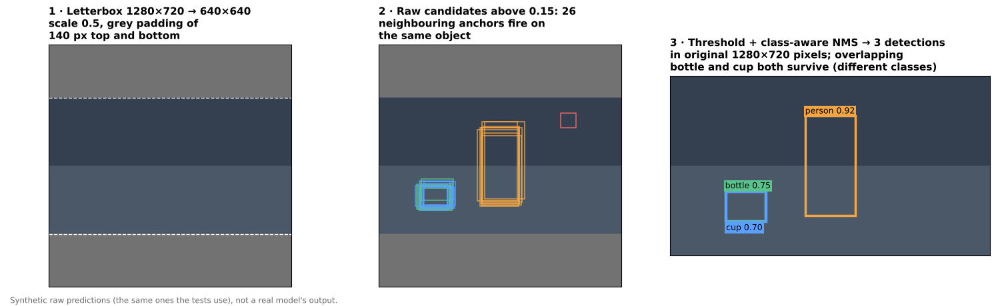

# 06 · Vision for robotics

Real-time object detection served as an API and built for robots: a **YOLO ONNX** detector with pre- and post-processing **written from scratch in NumPy** (letterbox, decode, class-aware NMS), a **multi-object tracker**, **pixel → bearing / distance** geometry, a **follow-me controller** that outputs velocity commands for the 05-quadruped, and a **latency benchmark**.

```
camera frame → letterbox 640² → ONNX Runtime (CPU / CUDA / CoreML) → decode + NMS → un-letterbox
            → IoU tracker (stable IDs) → bearing° / distance m → {"vx": 120, "yaw_rate_deg": -14}
```



## Quick start

```bash
pip install -e ".[dev]"
# 1. get a model: export once with Ultralytics (on any machine), copy the .onnx here
pip install ultralytics && yolo export model=yolo11n.pt format=onnx imgsz=640   # also try imgsz=320 for a Pi
mkdir -p models && mv yolo11n.onnx models/

# 2. serve it
VISION_MODEL=models/yolo11n.onnx uvicorn vision.api:app --port 8001
curl -F file=@street.jpg localhost:8001/detect
curl -F file=@street.jpg localhost:8001/detect/annotated -o boxes.jpg
curl -F file=@me.jpg "localhost:8001/follow?target=person"

# 3. live camera (+ follow commands for the robot)
python -m vision.camera --model models/yolo11n.onnx --follow person

# 4. benchmark
python -m vision.bench --model models/yolo11n.onnx --label "Laptop CPU"
```

## API

| endpoint | returns |
|---|---|
| `POST /detect` | boxes, labels, scores, **bearing°** per object, and a timing breakdown (pre / infer / post). `?track=true` adds stable track IDs |
| `POST /detect/annotated` | JPEG with boxes drawn |
| `POST /follow?target=person` | best match plus `{"vx", "yaw_rate_deg", "status"}` to steer a robot towards it |
| `GET /metrics` | request count, p50 / p95 / p99 latency |

## Benchmarks

<!-- RESULTS:START -->
*Run `python -m vision.bench` on your laptop, a Raspberry Pi 5 and a Colab T4, and paste `results/bench.md` here. Comparing 640 vs 320 input and CPU vs GPU is the interesting part for a robot.*
<!-- RESULTS:END -->

## How it works

- **Letterbox:** resize keeping aspect ratio, pad to 640×640 with grey (114), and remember scale and padding so boxes map back exactly.
- **Decode:** the YOLOv8/11 output is `[1, 4+80, 8400]` (cx, cy, w, h plus class scores per anchor). Take the argmax class, apply the threshold, convert to corners.
- **Class-aware NMS** in one pass: each class's boxes are offset far apart, so a cup next to a bottle survives but duplicate persons don't.
- **Tracker:** greedy IoU matching against constant-velocity predictions, matching only within a class, so IDs survive missed frames.
- **Robot geometry:** `bearing = atan(Δx / f)` with `f = (W/2) / tan(HFOV/2)` (Pi Camera v2: 62.2°), and pinhole distance from a known object height. `follow_command` turns towards the target and walks until it fills ~12% of the frame, backing off if too close.

## Tests

`python -m vision.figures` regenerates the figure above. `pytest` runs 10 tests with **no model download**. `vision/fake_model.py` builds a tiny valid ONNX graph with YOLO's exact input/output contract, so the **real ONNX Runtime → postprocess → API** path is exercised end to end:

- letterbox geometry, IoU, NMS, decode and un-letterbox to exact pixel coordinates, transposed output layouts, clipping
- duplicate suppression vs different-class overlap, confidence and class filters
- API: detect, annotated JPEG, follow, bad image → 400, metrics
- tracker: IDs survive motion and a missed frame and never jump classes
- bearing and distance maths against closed-form values; follow logic turns the right way and backs off

## What I learned

ONNX Runtime · YOLO output decoding · NMS · letterboxing · multi-object tracking · camera geometry · latency budgets on edge devices
